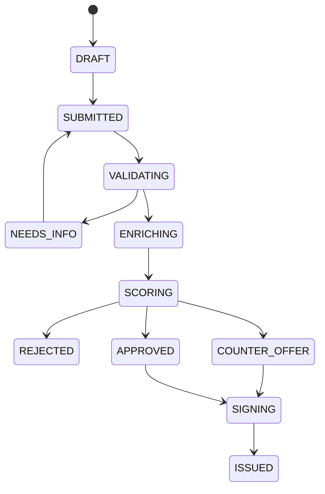

# Credit Synth: генератор данных для «Умного кредитного кабинета»

Рабочий компонент на **PyTorch: условный VAE + условный VGAE**. Генерирует новые
компании с финансовыми профилями и графом контрагентов, затем строит связанные
таблицы кредитного процесса. В комплекте исходники, обученные демовеса, готовый
датасет, Docker и автоматические проверки.

Это компонент генерации данных, а не весь личный кабинет из ТЗ. Веб-интерфейс,
аутентификацию и HTTP API кредитного продукта нужно реализовать отдельно.

**Исходных банковских данных нет.** Демовеса обучены на явно заданном
синтетическом симуляторе. Они воспроизводят его предположения, а не реальную
статистику клиентов Альфа-Банка. Генератор полезен для наполнения прототипа,
интеграционных тестов и экспериментов. Из этих данных нельзя получить
подтвержденное качество реального скоринга или рекомендательной системы.

## Запуск за минуту после установки зависимостей

Рекомендуется Python **3.12**, CPU, Linux x86-64. GPU, PyG, внешние сервисы и
платные ресурсы не нужны. Установка зависимостей и сборка Docker требуют интернета;
генерация с готовыми весами работает локально без сети.

```bash
python3.12 -m venv .venv
source .venv/bin/activate
python -m pip install -r requirements.txt

# Из корня проекта. По умолчанию добавляются еще 5 фиксированных E2E-примеров.
python -m credit_synth generate \
  --model demo/model --out output/generated --companies 1000 --seed 123

python -m credit_synth validate --data output/generated
python -m credit_synth evaluate --model demo/model --data output/generated
```

Для Windows PowerShell активация окружения: `.venv\Scripts\Activate.ps1`.
Проверенная сборка зависимостей предназначена для Linux x86-64; для других
платформ потребуется подходящая CPU-сборка PyTorch.

Готовые данные уже находятся в `demo/generated/`, веса - в `demo/model/`.
`python -m credit_synth --help` показывает все команды.

### Docker

```bash
docker compose run --rm generator
```

Результат: `output/generated/`. При работе контейнеру отключена сеть.
Вариант с параметрами:

```bash
docker build -t credit-synth .
docker run --rm --network none -v "$PWD/output:/data" credit-synth \
  generate --model demo/model --out /data/generated --companies 2000 --seed 7
```

## Что генерируют нейросети

1. **CVAE** обучает `q(z | x, c)` и `p(x | z, c)`, где `c` - условие
   `healthy / borderline / distressed`. Числовые признаки имеют гауссовы головы
   с обучаемой дисперсией, категориальные - отдельные softmax-головы. При генерации
   и латентный вектор, и значения признаков сэмплируются. Логарифмирование,
   стандартизация, KL warm-up и выбор лучшей эпохи по validation входят в код.
2. **Conditional VGAE** обучает GCN-постериор `q(z | X, A_train)`,
   признаковый prior `p(z | X)` и dot-product decoder связей `TRADE_WITH`.
   Обучаемый условный prior нужен, чтобы создавать связи между **новыми**
   компаниями без исходной матрицы смежности. Это адаптация VGAE, а не точная
   реализация модели Кипфа-Веллинга. Граф контрагентов - дополнительный слой,
   который не требуется ТЗ и может быть отключен при обучении.
3. **Правила согласования** строят ID, внешние ключи, 12 месяцев финансов,
   документы, мок-проверки, решения и хронологию. Эти части не выдаются за
   нейросетевую генерацию. Нейросеть задает профили; правила обеспечивают
   проверяемый кредитный путь.

Целевая функция CVAE: сумма Gaussian NLL числовых признаков, categorical NLL
и KL к `N(0, I)`; коэффициент KL постепенно возрастает до 1.
VGAE использует balanced BCE по положительным/отрицательным ребрам и
`0.03 * KL(q(z|X,A) || p(z|X))` с warm-up. Это взвешенная обучающая цель.

GCN работает по разреженному списку ребер, без матрицы `N × N`. Генерация графа
берет ограниченный равномерный набор пар-кандидатов и выбирает ребра взвешенным
сэмплированием без повторений. Число ребер сохраняет среднюю степень исходного
графа. Сложность при фиксированной степени и числе кандидатов - порядка `O(N)`.
Это приближение с ограниченным набором кандидатов, а не полный Bernoulli-граф.
`decoder_score` является ранжирующей оценкой, **не** калиброванной вероятностью
связи и тем более не вероятностью дефолта.

### Управление составом данных

```bash
# 20% healthy, 30% borderline, 50% distressed; без фиксированных примеров.
python -m credit_synth generate \
  --model demo/model --out output/stress --companies 5000 \
  --mix 0.2 0.3 0.5 --seed 77 --no-fixtures --as-of 2026-10-19
```

Условие задает финансовый режим, а не гарантированное решение банка.
Термин `scenario` здесь не означает целевой класс дефолта.

## Обучение с нуля

```bash
# Все шаги одной командой.
python -m credit_synth demo --out my_demo \
  --train-rows 4000 --companies 1000 --epochs 60 --graph-epochs 80 --seed 42

# Либо по отдельности.
python -m credit_synth bootstrap --out data/reference --rows 4000 --seed 42
python -m credit_synth train --data data/reference --out artifacts \
  --epochs 60 --graph-epochs 80 --seed 42
python -m credit_synth generate --model artifacts --out output/custom --companies 1000
```

`bootstrap` - открыто описанная в `simulator.py` вымышленная предметная модель.
При наличии собственного исходного набора пропусти этот шаг и подай свои CSV.
Если графа нет: `train ... --skip-graph`. Генерация тогда сохранит пустую таблицу
связей и все остальные сущности; графовые веса не создаются.

### Контракт входных данных

`profiles.csv`: **одна строка на компанию**, все поля обязательны. Дубликаты
компаний, неизвестные категории, пропуски и значения вне диапазонов отклоняются.
Для другой области значений нужно изменить `schema.py` и переобучить модель.

| Поле | Смысл / значения |
|---|---|
| `company_id` | Уникальный ID компании |
| `scenario` | `healthy`, `borderline`, `distressed`; условие генерации |
| `sector` | `retail`, `services`, `manufacturing`, `logistics`, `it` |
| `region` | `central`, `north_west`, `volga`, `south`, `ural`, `siberia` |
| `legal_form` | `LLC`, `IE` |
| `product_id` | `working_capital`, `equipment`, `credit_line` |
| `term_months` | 6, 12, 24, 36, 60; допустимые сроки зависят от продукта |
| `company_age_months` | Возраст компании: 3..180 месяцев, целое |
| `headcount` | Число сотрудников: 1..100, целое |
| `monthly_revenue` | Средняя месячная выручка: 150 тыс...15 млн руб. |
| `margin` | Доля операционного денежного потока: 0.02..0.48 |
| `debt_to_revenue` | Текущий долг / месячная выручка: 0..6 |
| `liquidity_months` | Денежный резерв / месячный оп. поток: 0..12 |
| `revenue_volatility` | Параметр месячного шума выручки: 0.01..0.5 |
| `overdue_days` | Дни просрочки: 0..180, целое |
| `requested_to_revenue` | Запрошенная сумма / месячная выручка: 0.2..12 |
| `collateral_coverage` | Условное покрытие обеспечения: 0..2 |

`company_links.csv`: `source_company_id,target_company_id` - неориентированные
связи между существующими компаниями; самосвязи запрещены. Дубликаты пар
объединяются. Для обучения графу нужно не менее 30 ребер и достаточно несвязанных
пар для train/validation/test. Пример файлов есть в `demo/reference/`.

Разбиение профилей: **70/15/15 по уникальным компаниям**, стратифицированно по
условию. Скейлер обучается только на train. Все три условия должны присутствовать,
каждое минимум в 10 компаниях; всего нужно минимум 100 строк. В реальном наборе
условия надо определить по признакам, доступным на дату заявки.

Разбиение ребер: **80/10/10**, encoder получает только train-ребра. Отрицательные
примеры не пересекаются ни с одним положительным ребром; тестовые и валидационные
отрицательные пары исключены из обучающих. Графовые метрики относятся к
**transductive link prediction**: все узлы известны при обучении. Качество графа
на новых компаниях отдельно не подтверждено, хотя prior позволяет его генерировать.

## Выходные данные

В каталоге результата есть отдельные CSV, общий `dataset.json`, `dataset.sqlite`
с внешними ключами и `schema.sql`.

| Таблица | Содержимое |
|---|---|
| `companies` | Компании, отрасль, регион, численность |
| `clients` | Синтетические представители компаний |
| `memberships` | Полномочия и владение; MVP: один владелец на компанию |
| `employees` | Банковские сотрудники трех ролей |
| `products` | Три вымышленных продукта и ограничения |
| `profiles` | Нейросетевой финансовый снимок и метаданные сценария |
| `financials_monthly` | 12 месяцев выручки, расходов, прибыли, долга и ликвидности |
| `applications` | Сумма, срок, цель, ответственный, текущий статус |
| `documents` | Наличие и синтетический текст трех документов |
| `external_checks` | Ответы `FNS_MOCK`, `BKI_MOCK` |
| `decisions` | Отдельное решение, причина, демобалл риска, DSCR, сумма предложения |
| `application_events` | Последовательная история переходов |
| `loans` | Только смоделированные выдачи |
| `company_links` | Граф связей контрагентов из VGAE |

`fixtures.json` содержит ID пяти проверяемых историй: `approved`, `rejected`,
`needs_info`, `counter_offer`, `issued`. Это **ручные интеграционные примеры**,
они помечены `is_fixture` и исключены из оценки качества нейросети.
`--companies 1000` означает 1000 нейросетевых компаний + 5 таких примеров.

## Модель кредитного процесса и ограничения



Генератор сохраняет одну историю на заявку: остановку на запросе сведений,
решении или смоделированной выдаче. Повторная подача и принятие встречного
предложения разрешены моделью состояний, но не генерируются в этом MVP.

Демологика: сначала полнота документов, затем возраст бизнеса, просрочки и
денежный поток. `DSCR = revenue * margin / (existing_debt / 24 + annuity)`.
Неполные документы ведут к `NEEDS_INFO`; просрочка от 60 дней, возраст меньше
6 месяцев, маржа меньше 6% или DSCR < 0.75 - к отказу. При DSCR >= 1.25 и
просрочке до 10 дней возможно одобрение; иначе проверяется уменьшенный лимит.
Ставки и пороги **вымышленные**, не условия банка. Демобалл риска сам по себе
не определяет решение и не интерпретируется как PD.

В текущем симуляторе все регистрации компаний проходят проверку. Документы -
текстовые записи, без файлов PDF и OCR. Кредитная линия считается по аннуитетной
аппроксимации. Подписание и выдача - только записи. Профиль представляет один
снимок; помесячная история условно строится вокруг него, не моделирует будущие
просрочки, поведение заемщика или денежные потоки контрагентов.

Ограничения декодера (диапазоны и совместимость продукта со сроком) применяются
явно; число исправлений записывается в `metadata.json -> projection_counts`.
Большое число исправлений - повод улучшать модель/обучение, а не скрывать эффект.

Для последующего скоринга/RecSys исключи `scenario`, `fixture_case`, `is_fixture`,
решения и последующие события из входных признаков. Целевой метки реального
дефолта здесь нет; временной пользовательской истории для BERT4Rec тоже нет.
При обучении на реальных данных защита от запоминания требует отдельной работы;
VAE и проверка ближайших соседей сами по себе не гарантируют приватность.

## Проверки и метрики

```bash
python -m unittest discover -s tests -v
python -m credit_synth validate --data demo/generated
python -m credit_synth evaluate --model demo/model --data demo/generated
```

`validation.json` проверяет ключи, принадлежность документов компании,
полномочия заявителя, правила продукта, бухгалтерские тождества, суммы и
аннуитеты, последовательность и даты событий, решения и пять контрольных историй.
SQLite дополнительно проверяется через `PRAGMA foreign_key_check`.

`quality.json` содержит KS по числам, total variation по категориям, ошибку
корреляций, условные KS, ROC-AUC классификатора real-vs-synthetic на его отдельном
hold-out и расстояния до обучающих строк. Сравнение идет с **test-частью
исходного источника**, фиксированные E2E-примеры исключены. Метрики не являются
оценкой качества реальных банковских решений. Они также зависят от выбранной
смеси сценариев и размера выборки.

`demo/model/training_manifest.json` содержит параметры разбиения и метрики
моделей. Датасет хранит seed, дату, источник обучения, SHA-256 весов и отчеты
проекции. При одинаковом окружении, числе компаний, параметрах и seed CSV
генерируются воспроизводимо. Между версиями PyTorch/платформами полное битовое
совпадение не обещается.

### Python API

```python
from pathlib import Path
from credit_synth.generate import generate

report = generate(
    model_dir=Path("demo/model"), out=Path("output/python"),
    companies=1000, seed=123, mix=[0.55, 0.30, 0.15],
    as_of="2026-10-19", include_fixtures=True,
)
assert report["valid"]
```

### Проверка сквозного примера

Открой `fixtures.json`, выбери `application_id` для `issued` и найди его в
`applications`, `documents`, `external_checks`, `decisions`, `application_events`,
`loans`. Должны быть положительное решение, переходы до `ISSUED` и одна выдача.
У `needs_info` отсутствует выписка; у `rejected` есть серьезная просрочка;
у `counter_offer` предложенная сумма меньше запрошенной. Для своего прототипа
импортируй SQLite или таблицы в этом же порядке по схеме внешних ключей.

Исследовательская основа: [VAE](https://arxiv.org/abs/1312.6114),
[VGAE](https://arxiv.org/abs/1611.07308).
Сторонние компоненты и все смоделированные интеграции перечислены в
`THIRD_PARTY_NOTICES`. Дополнительных переменных окружения и ключей API нет.
