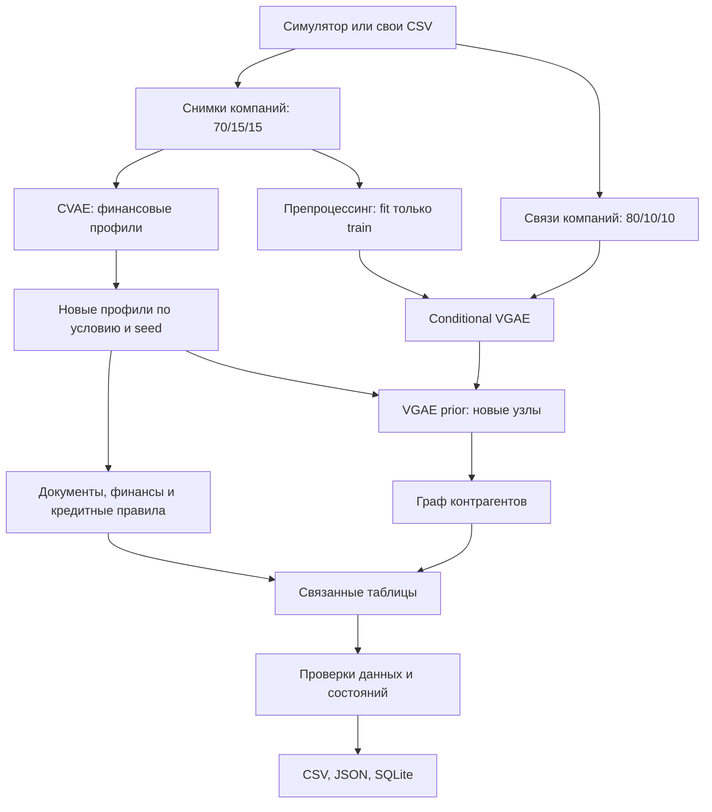

# Архитектура компонента

Оценка CVAE проводится на test-компаниях. Графовая оценка проводится на
отложенных ребрах между известными узлами. Эти два протокола нельзя смешивать:
графовая метрика не измеряет перенос на новые компании.

Источники данных и API моки полностью локальны. Компонент имеет CLI и Python API;
сетевого API и веб-интерфейса у него нет. Внешние ключи перечислены в
`credit_synth/export.py`, SQL конечной схемы - в `demo/generated/schema.sql`.
Состояния процесса и ограничения перечислены в `README.md` и `schema.py`.

Расширение: для типизированных отношений владения и взаимодействий потребуется
другая графовая модель и другой контракт данных. Текущий VGAE генерирует только
неориентированный граф контрагентов; обязательные структурные связи создаются
правилами, а не вероятностным декодером.
