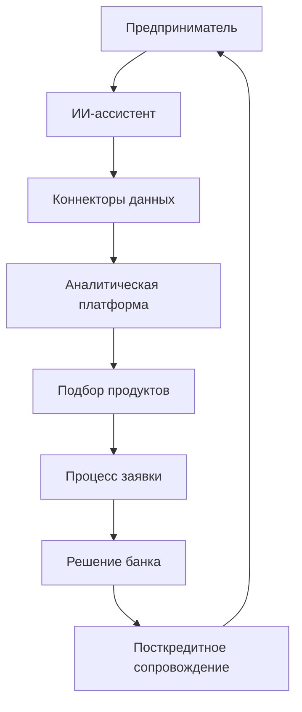

# Концепция «Умный кредитный кабинет ММБ»

## 1. Контекст и цель
- Создать цифровой кабинет предпринимателя, где ключевую ценность даёт ИИ-ассистент, который понимает модель бизнеса, подбирает продукт и сопровождает весь путь заявки.
- Выделиться за счёт глубокой аналитики бизнеса, персонализации и интеграций с экосистемой (банковские сервисы, бухгалтерия, маркетплейсы, POS, фискальные данные).

## 2. Сегменты пользователей
1. **Соло-предприниматели услуг** — кэшфлоу нестабилен, мало финансовой грамотности, нужен «персональный CFO».
2. **Розничные и e-commerce микробизнесы** — оборот идёт через маркетплейсы/эквайринг, важно планирование оборотного капитала.
3. **Производственные/оптовые СМБ** — сложные цепочки поставок, нуждаются в проектном финансировании и быстрых решениях по складскому кредиту.
4. **IT и креативные студии** — высокая маржинальность, но мало залогов; акцент на репутационные и контрактные данные.

## 3. Ключевые боли и возможности
- **Непрозрачный кредитный путь** → визуализировать статус заявки, требования и прогнозы сроков.
- **Неумение подготовить финансовый пакет** → ассистент автоматически подтягивает отчётность, строит P&L и cash-flow.
- **Страх отказа** → режим «песочницы»: симуляция заявки, подсказки по улучшению показателей.
- **Отсутствие совета по продукту** → ИИ сравнивает сценарии (овердрафт, факторинг, оборотный кредит, лизинг).
- **Нет единой картины бизнеса** → консолидированный дашборд по всем каналам продаж и расходам.

## 4. Роли ИИ-ассистента
1. **Business Insight Copilot** — собирает данные из подключённых источников, объясняет динамику метрик человеческим языком.
2. **Product Matchmaker** — строит кредитный профиль, находит подходящие продукты/программы господдержки, объясняет условия.
3. **Application Architect** — ведёт пользователя через требуемые документы, генерирует резюме бизнеса, проверяет полноту пакета.
4. **Negotiation Navigator** — моделирует ставки/сроки, предлагает компромиссы, показывает эффект на DSCR.
5. **Aftercare Mentor** — мониторит ковенанты, предупреждает о рисках, рекомендует шаги для улучшения финансового здоровья.

## 5. Аналитические сервисы
- **Дашборд «Здоровье бизнеса»**: индекс устойчивости, прогноз оборота, структура расходов.
- **Аномалия-детектор**: предупреждает о кассовых разрывах, сезонных ямах, повышенных рисках.
- **Сценарный симулятор**: «что будет, если увеличить рекламный бюджет», «как изменится DSCR при новом заказе».
- **Прозрачный кредитный рейтинг**: объяснимость факторов, рекомендации по улучшению.
- **Peer-benchmarking**: сопоставление с «похожими» бизнесами (обезличенно).

## 6. Пользовательский путь
1. **Онбординг**: подключение данных (банк, бухгалтерия, маркетплейсы), формирование бизнес-профиля.
2. **Диагностика**: ассистент даёт обзор текущего состояния, выявляет цели (оборот, инвестиции, техника и т.д.).
3. **Кредитная лаборатория**: подбор продуктов, симуляции, советы по документам, расчет лимитов.
4. **Заявка**: автозаполнение форм, контроль качества пакета, цифровая подпись.
5. **Решение**: трекинг этапов, двусторонний чат с риск-офицером, прозрачные статусы.
6. **Сопровождение**: мониторинг выполнений условий, предложения по оптимизации, раннее предупреждение проблем.

## 7. Дифференцирующие идеи
- **Индивидуальный «финансовый сюжет»**: визуальное повествование о бизнесе для кредитного комитета (narative-based underwriting).
- **MarketPulse API**: подключение внешних данных (маркетплейсы, POS, фискальные кассы, логистика) в один клик через каталог коннекторов.
- **Программа «ИИ-куратор»**: ассистент не только отвечает, но и проактивно ведёт задачи (напоминает о документах, обновляет прогнозы).
- **Совместный режим**: предприниматель может пригласить бухгалтера/партнёра/банковского менеджера в ту же заявку с ролями.
- **Геймификация устойчивости**: баллы за выполнение рекомендаций, открывающие лучшие условия.
- **Impact-оценка**: анализ ESG/социального вклада малого бизнеса для доступа к льготным программам.

## 8. Партнёрские интеграции
- **Бухгалтерия**: МоёДело, Контур, 1C — автоимпорт отчётности.
- **Продажи**: Ozon, Wildberries, Yandex Market, CRM (Amo, Bitrix) — потоковая аналитика заказов.
- **Платежи**: Банковский эквайринг, CloudPayments, Square — анализ конверсий и чеков.
- **Госсервисы**: ФНС, ФССП, Росстат — быстрый комплаенс.
- **Маркетинг и логистика**: рекламные кабинеты, службы доставки для прогнозов оборота.

## 9. Схема взаимодействий

## 10. Следующие шаги
1. Приоритизировать сегменты и определить MVP-гипотезы по ИИ-фичам.
2. Сформировать CJM с UX-референсами и KPI.
3. Прописать требования к данным и интеграциям.
4. Подготовить прототип ассистента (скрипты диалогов, примеры аналитики).
